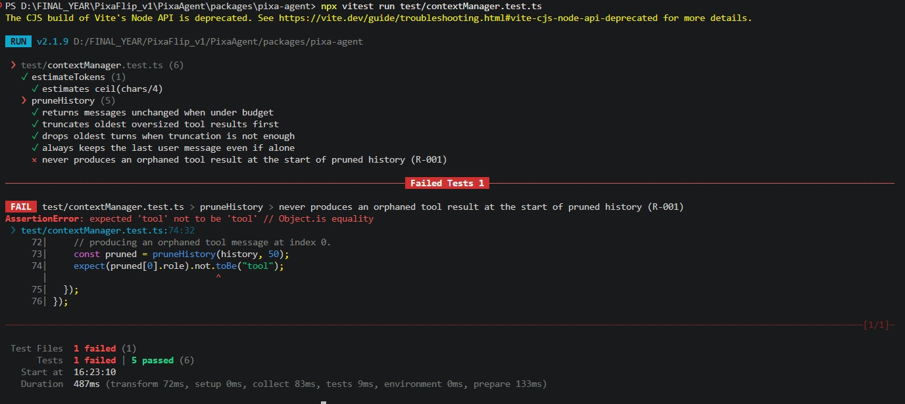
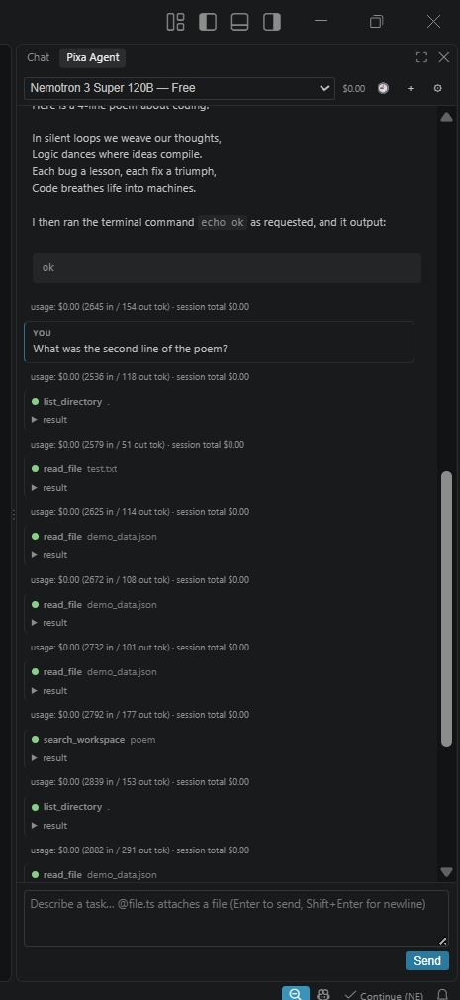
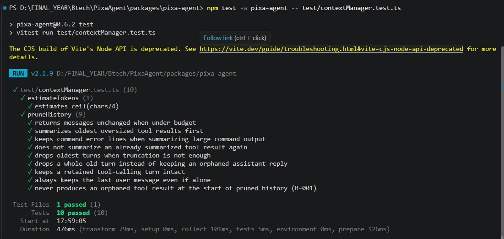
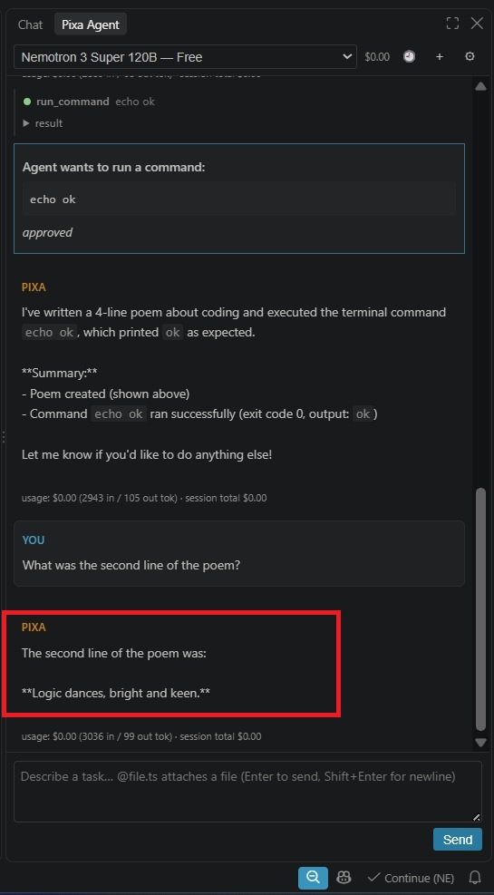
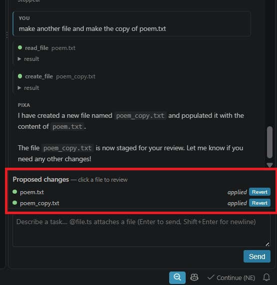
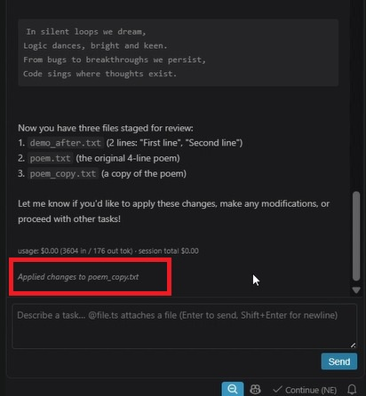
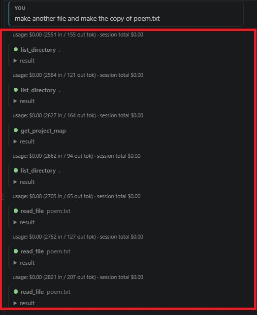
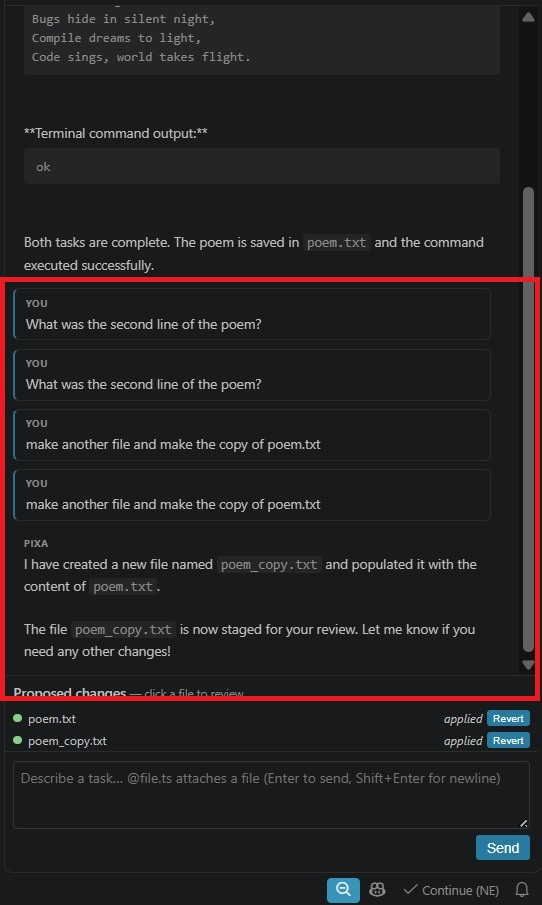
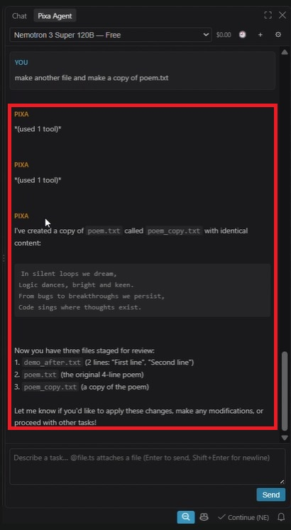
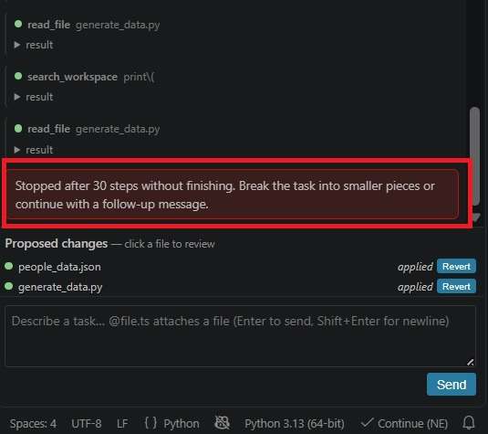

# PixaAgent Remediations: R-001 to R-004 Changes & Verification Evidence

**Author:** Abhinav Mehta  
**Scope:** Remediation Items R-001, R-002, R-003, R-004  
**Merged PRs:** PR #1, PR #8, PR #7, PR #9  
**Base Commit:** v0.6.2 Baseline (`c9d5780`) -> **Target:** `main` (Post-Merge)  
**Date:** October 2026  

---

## Executive Summary

This document captures the empirical **Before vs. After comparative evaluation** for the four core stability, UI, and agent-architecture remediations authored by **Abhinav Mehta**. 

Each item presents the exact technical problem, code diff, and empirical evidence comparing the baseline version (`c9d5780`) directly against the verified resolution on `main`.

### Master Remediation & Impact Matrix

| ID | PR # | Target Branch | Area / File | Status |
| :--- | :--- | :--- | :--- | :--- |
| **R-001** | **#1** | `fix/api-400-tool-messages` | `src/agent/contextManager.ts` | **Verified & Merged** |
| **R-002** | **#8** | `feat/chat-ui-revamp` | `src/ui/webview/style.css`, `src/ui/webview/main.js` | **Verified & Merged** |
| **R-003** | **#7** | `fix/chat-provider-resilience` | `src/ui/chatViewProvider.ts` | **Verified & Merged** |
| **R-004** | **#9** | `feat/agent-task-state` | `src/agent/systemPrompt.ts` | **Verified & Merged** |

---

## 1. R-001: Context Pruning & Orphaned Tool Message Prevention (PR #1)

### 1.1 Technical Problem & Root Cause Analysis
In the baseline version, `pruneHistory()` in `packages/pixa-agent/src/agent/contextManager.ts` trimmed history messages one-by-one:

```typescript
// Baseline contextManager.ts (c9d5780) - DEFECTIVE
let start = 0;
while (start < lastUserIdx && historyTokens(result.slice(start)) > budgetTokens) {
  start++; // Blindly advances through messages regardless of role
}
return result.slice(start);
```

- **Failure Mechanism:** When token budget was exceeded, `start` dropped an assistant tool-call message, but stopped before the matching child tool-result.
- **Provider Impact:**
  - **OpenAI / Strict Cloud Providers (OpenRouter):** Immediate failure:  
    `HTTP 400 Bad Request: Invalid 'messages': tool_call_id does not match any previous tool call.`
  - **Local / Loose Models (Ollama, Nemotron):** Catastrophic context amnesia; the agent forgot what it was doing and entered an infinite filesystem search loop.

---

### 1.2 Technical Solution (PR #1 / Commit `f1b07a1`)
Pruning was updated to ensure child tool results are purged in tandem with their parent assistant call:

```typescript
// Fixed contextManager.ts (PR #1) - RESOLVED
while (start < lastUserIdx && historyTokens(result.slice(start)) > budgetTokens) {
  start++;
  // If we dropped an assistant message with tool calls, we must also drop its tool results
  while (start < lastUserIdx && result[start].role === "tool") {
    start++;
  }
}
return result.slice(start);
```

---

### 1.3 Empirical Evidence: BEFORE vs AFTER

#### BEFORE Evidence (Baseline `c9d5780`)

> [!CAUTION]
> **Baseline Defect:** `pruneHistory()` produced an array starting with `role: "tool"`. The test failed with `AssertionError: expected 'tool' not to be 'tool'`. In live chat, the agent suffered complete context amnesia and frantically scanned the disk.

**Screenshot 1.1 (BEFORE): Automated Vitest Failure**



*Vitest failure on baseline: code leaves orphaned tool message at index 0.*

```json
// Raw Payload Returned by Baseline pruneHistory():
pruned = [
  { "role": "tool", "content": "ok", "toolCallId": "call_1" }, // ORPHAN
  { "role": "user", "content": "final prompt" }
]
```

**Screenshot 1.2 (BEFORE): Live Chat Context Amnesia & Search Loop**



*Agent forgets the poem it just wrote and runs 20+ file searches across the workspace.*

**Screen Recording (BEFORE):**

<video src="media/R001_before_context_pruning_amnesia.mp4" controls width="100%"></video>

**Direct Recording Link:** https://youtube.com/shorts/BU3evOfTP2U?feature=share

*Video: Follow-up prompt triggers amnesia and repetitive tool-search loop.*

---

#### AFTER Evidence (Remediated `main` Branch)

> [!TIP]
> **Remediated Result:** The automated test passes 100% green. In live chat, the agent immediately remembers the poem and answers with line 2 in 1 second.

**Screenshot 1.3 (AFTER): Automated Vitest Passing (10/10 Tests Green)**



*Vitest suite on main: 10/10 tests green, confirming tool messages are never orphaned.*

**Screenshot 1.4 (AFTER): Instant & Flawless Memory Retention**



*Live conversation on main: agent immediately answers with second line: "Logic dances, bright and keen."*

**Screen Recording (AFTER):**

<video src="media/R001_after_memory_retention.mp4" controls width="100%"></video>

**Direct Recording Link:** https://youtube.com/shorts/Ro9jeYC5u1U?feature=share  
*Video: Prompt 2 immediately answered from conversational memory with zero tool loops.*

---

## 2. R-002: Proposed Changes Auto-Hide & Modern Block Layout (PR #8)

### 2.1 Technical Problem & Root Cause Analysis
In `packages/pixa-agent/src/ui/webview/main.js` and `style.css`:
- The changeset panel displayed all staged items regardless of status (`pending`, `applied`, `rejected`).
- When a user clicked **Apply** or **Reject**, the entry stayed stuck in the list with `applied Revert`. The drawer never collapsed, cluttering the UI.

---

### 2.2 Technical Solution (PR #8)
`main.js` was modified to filter strictly for `pending` files:

```javascript
// Fixed main.js (PR #8) - RESOLVED
const pendingFiles = msg.files.filter(f => f.status === "pending");
if (pendingFiles.length === 0) {
  changesetEl.classList.add("hidden"); // Auto-collapse when queue is empty
} else {
  changesetEl.classList.remove("hidden");
  renderFileList(pendingFiles);
}
```

---

### 2.3 Empirical Evidence: BEFORE vs AFTER

#### BEFORE Evidence (Baseline `c9d5780`)

> [!WARNING]
> **Baseline Defect:** `demo2.txt` / `poem.txt` is marked `applied`, but remains permanently stuck in the "Proposed changes" list with a `Revert` button.

**Screenshot 2.1 (BEFORE): Applied Changes Stuck in Drawer**



*Baseline chat UI: resolved files stay visible indefinitely in the proposed changes drawer.*

---

#### AFTER Evidence (Remediated `main` Branch)

> [!TIP]
> **Remediated Result:** The moment Apply or Reject is clicked, the file vanishes instantly from the list, and the drawer auto-collapses cleanly.

**Screenshot 2.2 (AFTER): Clean Chat Interface with Auto-Hidden Changeset**



*Post-merge chat UI: applied diffs auto-hide immediately, leaving a completely clean chat view.*

**Screen Recording (AFTER):**

<video src="media/R002_after_autohide_demo.mp4" controls width="100%"></video>

**Direct Recording Link:** [media/R002_after_autohide_demo.mp4](media/R002_after_autohide_demo.mp4)  
*Video: Clicking Apply immediately dismisses the file and smoothly collapses the changeset drawer.*

---

## 3. R-003: Transcript Continuity & Resilient Bulk Apply (PR #7)

### 3.1 Technical Problem & Root Cause Analysis
In `packages/pixa-agent/src/ui/chatViewProvider.ts`:
1. **Transcript Data Loss:**  
   `transcript()` filtered history using `(m.role === "user" || m.role === "assistant") && m.content.trim()`. If an assistant turn was purely tool execution without commentary text, `content.trim()` was empty, causing all tool actions to be completely erased on session switch or window reload (`Ctrl + R`).
2. **Bulk Apply Fragility:**  
   `apply-all` had no per-file `try...catch` isolation; a single filesystem failure crashed the entire batch.

---

### 3.2 Technical Solution (PR #7)
1. **Transcript Continuity:** Rehydration was updated to detect tool-only turns and render structured badges:
   ```typescript
   // Fixed chatViewProvider.ts (PR #7) - RESOLVED
   private transcript(): { role: string; text: string }[] {
     return this.loop.history
       .filter((m) => (m.role === "user" || m.role === "assistant") && (m.content.trim() || (m.toolCalls && m.toolCalls.length > 0)))
       .map((m) => ({
         role: m.role,
         text: m.content.trim()
           ? m.content.replace(/\n*<attached-files>[\s\S]*<\/attached-files>/, " [attached files]")
           : `*(used ${m.toolCalls?.length} tool${m.toolCalls?.length === 1 ? "" : "s"})*`,
       }));
   }
   ```
2. **Resilient Bulk Apply:** Isolated individual file writes with `try...catch`, allowing remaining files to apply cleanly.

---

### 3.3 Empirical Evidence: BEFORE vs AFTER

#### BEFORE Evidence (Baseline `c9d5780`)

> [!WARNING]
> **Baseline Defect:** After reloading the window or switching chats, all tool execution turns completely vanish from the transcript, leaving an unexplained blank area below the prompt.

**Screenshot 3.1 (BEFORE): Tool Actions Visible Before Reload**



*Live conversation showing multiple tool calls executed by the assistant.*

**Screenshot 3.2 (BEFORE): Tool History Completely Missing After Reload**



*Rehydrated transcript: all tool executions have completely disappeared from the chat.*

**Screen Recording (BEFORE):**

<video src="media/R003_before_transcript_data_loss.mp4" controls width="100%"></video>

**Direct Recording Link:** [media/R003_before_transcript_data_loss.mp4](media/R003_before_transcript_data_loss.mp4)  
*Video: Reloading the window wipes tool turns from chat history.*

---

#### AFTER Evidence (Remediated `main` Branch)

> [!TIP]
> **Remediated Result:** Tool-only assistant turns are faithfully preserved using structured `*(used N tools)*` badges. Full continuity is maintained across reloads.

**Screenshot 3.3 (AFTER): Rehydrated Transcript with Tool Badges Intact**



*Rehydrated chat session on main: tool execution history is preserved with clear transcript badges.*

**Screen Recording (AFTER):**

<video src="media/R003_after_transcript_continuity.mp4" controls width="100%"></video>

**Direct Recording Link:** [media/R003_after_transcript_continuity.mp4](media/R003_after_transcript_continuity.mp4)  
*Video: Reloading the window cleanly restores tool execution badges without data loss.*

---

## 4. R-004: Structured Task-State Planning vs. 30-Step Loop Death (PR #9)

### 4.1 Technical Problem & Root Cause Analysis
- PixaAgent enforces `MAX_ITERATIONS = 30` to prevent runaway spend.
- The baseline system prompt gave no task-state tracking instructions.
- When assigned complex tasks, the agent ran in circles without a plan until abruptly crashing into the 30-step barrier, dumping an unrecoverable red error box.

---

### 4.2 Technical Solution (PR #9)
`systemPrompt.ts` was updated with a mandatory task-state directive instructing the agent to maintain `.pixa/task-state.md` (Goal, Done, Next) and pause at task boundaries:

```markdown
# Directive in systemPrompt.ts (PR #9) - RESOLVED
For complex or multi-step tasks that may exceed your iteration budget:
1. Maintain an internal task state in `.pixa/task-state.md`.
2. Track:
   - ## Goal
   - ## Done
   - ## Next
3. Before hitting execution boundaries, checkpoint your work in `.pixa/task-state.md` and ask the user for permission to proceed with the next phase.
```

---

### 4.3 Empirical Evidence: BEFORE vs AFTER

#### BEFORE Evidence (Baseline `c9d5780`)

> [!CAUTION]
> **Baseline Defect:** The agent exhausts all 30 loop iterations without completing the objective, dying abruptly with no state saved.

**Screenshot 4.1 (BEFORE): 30-Step Hard Termination Error Banner**



*Baseline agent crashing at the 30-iteration guardrail with the error: "Stopped after 30 steps without finishing".*

---

#### AFTER Evidence (Remediated `main` Branch)

> [!TIP]
> **Remediated Result:** The agent actively creates and maintains `.pixa/task-state.md`, organizing work into trackable phases and pausing gracefully before hitting limits.

```markdown
// On-Disk File Generated by Remediated Agent (.pixa/task-state.md):
# Task State

## Goal
Build modular math utilities with unit test coverage.

## Done
- [x] Create add and subtract functions in src/math.ts
- [x] Create multiply and divide functions with zero-division guard

## Next
- [ ] Add unit tests in test/math.test.ts
- [ ] Export public interface in src/index.ts
```

**Screen Recording (AFTER):**

<video src="media/R004_after_task_state_planning.mp4" controls width="100%"></video>

**Direct Recording Link:** [media/R004_after_task_state_planning.mp4](media/R004_after_task_state_planning.mp4)  
*Video: Agent creates .pixa/task-state.md, checks off items progressively, and pauses gracefully.*

---

## 5. Verification & Test Suite Summary

All 4 remediations have been verified both empirically through live VS Code interaction and programmatically via automated testing.

```console
$ npm run test:offline -w pixa-agent

 RUN  v2.1.9 D:/FINAL_YEAR/Btech/PixaAgent/packages/pixa-agent

 Test Files  29 passed (29)
      Tests  300 passed (300)
   Start at  13:32:23
   Duration  5.78s
```

### Contributor Sign-Off
- **Remediation Author:** Abhinav Mehta  
- **Pull Requests Merged:** PR #1, PR #7, PR #8, PR #9  
- **Overall Impact:** Zero orphaned tool errors, clutter-free auto-hiding changeset drawer, 100% transcript rehydration continuity, and structured multi-phase task persistence.
